# PHI Focus

<p align="center">
  
</p>

<p align="center">
  <b>A privacy-first attention companion that protects your focus.</b><br>
  <i>Stay intentional. Your time matters.</i>
</p>

<p align="center">
  
  
  
  
</p>

---

## Table of Contents

1. [Introduction](#introduction)
2. [Tech Stack](#tech-stack)
3. [System Architecture](#system-architecture)
4. [Data Flow](#data-flow)
5. [Database Design](#database-design)
6. [Project Structure](#project-structure)
7. [Installation & Setup](#installation--setup)
8. [Browser Extension](#browser-extension)
9. [Privacy & Security](#privacy--security)
10. [Development Roadmap](#development-roadmap)
11. [Contributing](#contributing)
12. [License](#license)

---

## Introduction

### What is PHI Focus?

PHI Focus is a desktop application that runs quietly in your system tray, monitoring your app and website usage. When it detects you've been spending too much time on distracting content—particularly YouTube Shorts or other configured sites—it gently nudges you with a reminder to help you stay on track.

Named after the Greek letter Φ (Phi), representing the golden ratio and balance, PHI helps you maintain equilibrium between productive work and potentially time-wasting activities.

### Core Principles

| Principle | Description |
|-----------|-------------|
| 🔒 **Privacy First** | No keystrokes, no screenshots, no page content. Only app names, site domains, and time durations. |
| 💾 **Local Only** | Everything stays on your computer. No cloud, no accounts, no telemetry. |
| ⚙️ **Deterministic** | No AI making decisions—just simple, configurable rules you control. |
| 🎯 **Minimal** | Lightweight, unobtrusive, and respectful of system resources. |

### Key Features

- 📊 **Real-Time Monitoring** — Track active desktop applications and website usage via browser extension
- 🎬 **YouTube Shorts Detection** — Identify Shorts playback, count swipe gestures, enforce session/daily limits
- 💬 **Smart Nudge System** — Gentle popup reminders with configurable actions (stop, extend, pause, bypass)
- 📈 **Analytics Dashboard** — Today view, 7-day charts, timelines, top apps and sites breakdown
- ⚙️ **Fully Customizable** — Custom site limits, exclusion lists, adjustable thresholds

---

## Tech Stack

### Technology Overview

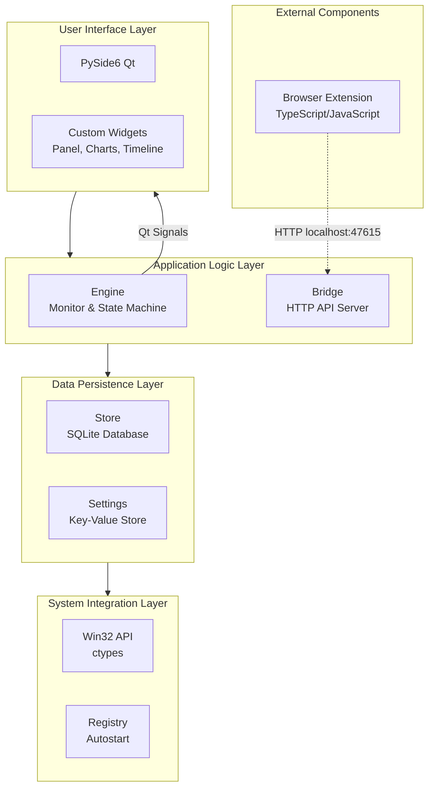

### Component Breakdown

| Component | Technology | Version | Purpose |
|-----------|------------|---------|---------|
| **UI Framework** | PySide6 (Qt for Python) | 6.6+ | Native cross-platform GUI |
| **Language** | Python | 3.11+ | Application logic |
| **Database** | SQLite | 3.x | Local data storage with WAL |
| **IPC Protocol** | HTTP (JSON) | - | Extension communication |
| **System APIs** | ctypes / Win32 | - | Windows integration |
| **Browser Extension** | TypeScript | - | Chrome/Firefox integration |

### Why These Technologies?

| Choice | Reason |
|--------|--------|
| **PySide6 (Qt)** | Native Windows look, rich animation framework, excellent signal/slot mechanism |
| **SQLite** | Zero-configuration, serverless, single file, WAL mode for concurrency |
| **Local HTTP** | Browser extensions can't access native APIs directly, HTTP is language-agnostic |
| **No AI/ML** | Deterministic rules are predictable, trustworthy, and user-controllable |

---

## System Architecture

### High-Level Architecture

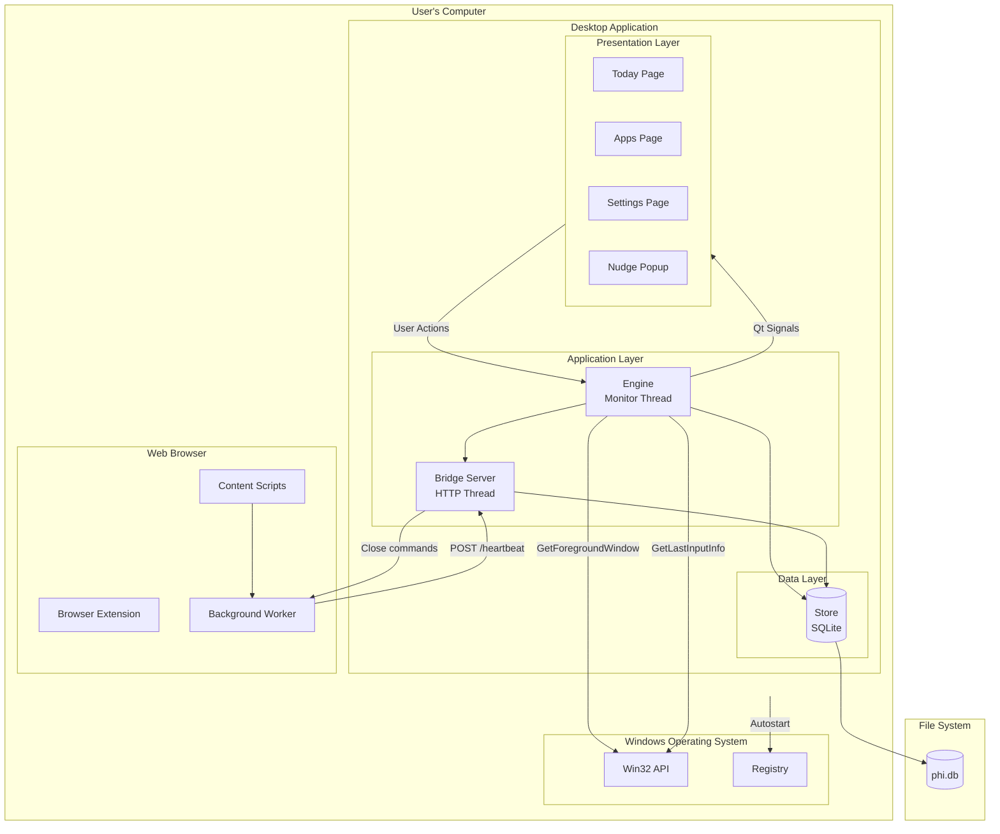

### Component Interaction

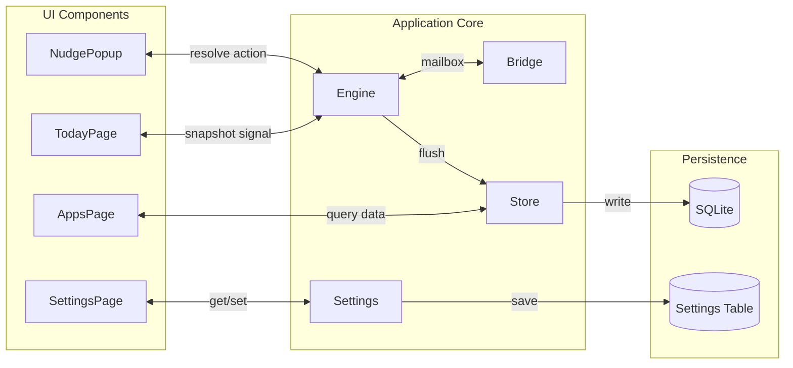

### Process Thread Model

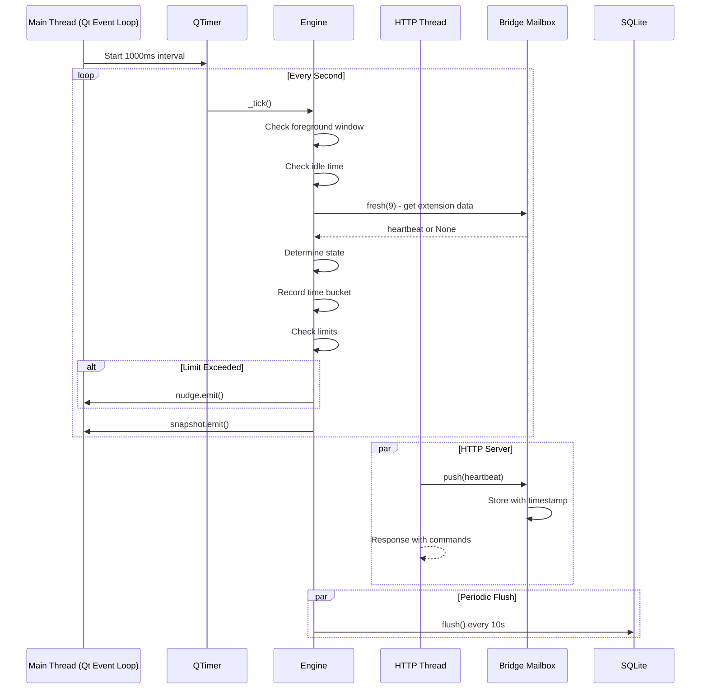

---

## Data Flow

### Monitoring Loop Sequence

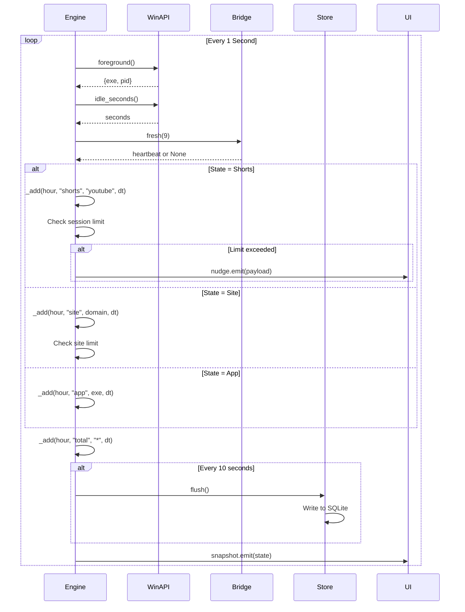

### Browser Extension Communication

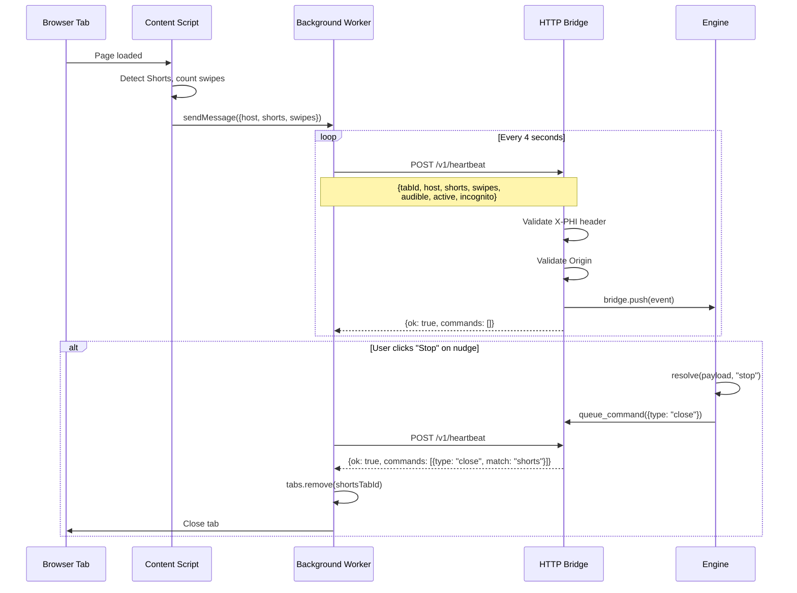

### Nudge Popup Flow

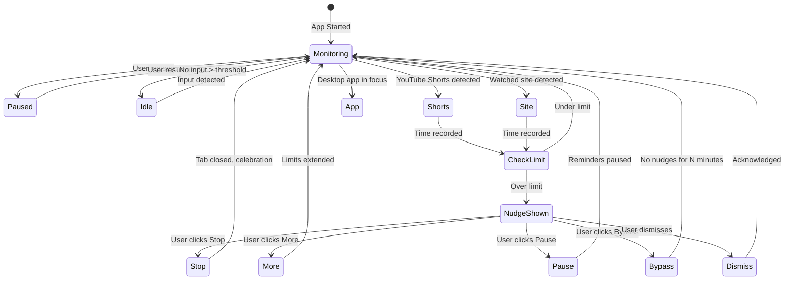

### UI Rendering Pipeline

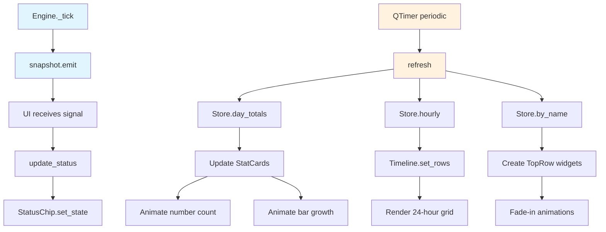

---

## Database Design

### Entity Relationship Diagram

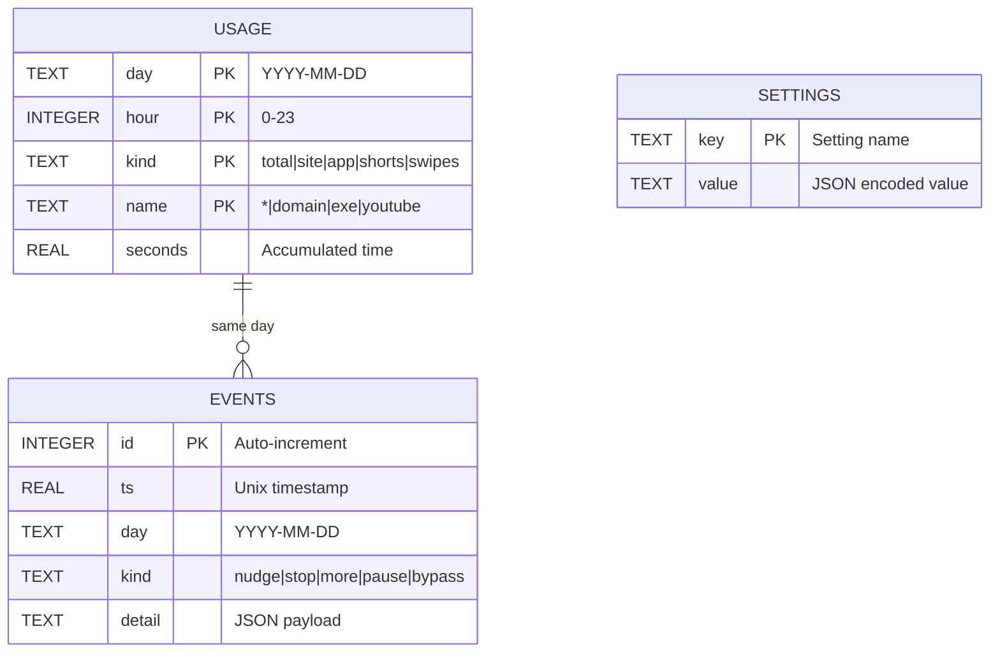

### Table Specifications

#### USAGE Table

| Column | Type | Description | Example |
|--------|------|-------------|---------|
| `day` | TEXT | ISO date (YYYY-MM-DD) | `"2024-01-15"` |
| `hour` | INTEGER | Hour of day (0-23) | `14` |
| `kind` | TEXT | Category of usage | `"site"`, `"shorts"` |
| `name` | TEXT | Specific identifier | `"youtube.com"` |
| `seconds` | REAL | Accumulated time | `1842.5` |

**Primary Key**: `(day, hour, kind, name)`

**Kind Values**:
- `total` / `*` — Total active time
- `site` / domain — Time on specific website
- `app` / exe — Time in desktop application
- `shorts` / `youtube` — YouTube Shorts time
- `swipes` / `shorts` — Swipe count

#### EVENTS Table

| Column | Type | Description |
|--------|------|-------------|
| `id` | INTEGER | Auto-increment ID |
| `ts` | REAL | Unix timestamp |
| `day` | TEXT | ISO date |
| `kind` | TEXT | Event type |
| `detail` | TEXT | JSON payload |

**Event Types**: `nudge`, `stop`, `more`, `pause`, `bypass`, `dismiss`

### Query Patterns

```sql
-- Today's totals by kind
SELECT kind, name, SUM(seconds)
FROM usage
WHERE day = DATE('now')
GROUP BY kind, name
ORDER BY SUM(seconds) DESC;

-- Hourly breakdown for a site
SELECT hour, SUM(seconds)
FROM usage
WHERE day = DATE('now')
  AND kind = 'site'
  AND name = 'youtube.com'
GROUP BY hour;

-- 7-day trend for Shorts
SELECT day, SUM(seconds)
FROM usage
WHERE day >= DATE('now', '-6 days')
  AND kind = 'shorts'
GROUP BY day;

-- Nudge events today
SELECT COUNT(*)
FROM events
WHERE day = DATE('now')
  AND kind = 'nudge';
```

---

## Project Structure

```
PHI_FOCUS/
├── phi/                          # Main Python package
│   ├── __init__.py              # Package metadata
│   ├── __main__.py              # Entry point
│   ├── app.py                   # Application setup
│   ├── engine.py                # Monitoring engine
│   ├── db.py                    # SQLite store
│   ├── server.py                # HTTP bridge
│   ├── winapi.py                # Windows API
│   ├── utils.py                 # Helpers
│   ├── autostart.py             # Registry config
│   └── ui/                      # UI components
│       ├── theme.py             # Design tokens
│       ├── widgets.py           # Custom widgets
│       ├── pages.py             # Main pages
│       └── mascot.py            # Mascot animation
├── extension/                   # Browser extension (TODO)
├── tools/                       # Development tools
├── build/                       # Built executable
├── .venv/                       # Virtual environment
└── requirements.txt             # Dependencies
```

### Module Responsibilities

| Module | Responsibility |
|--------|---------------|
| `engine.py` | Monitoring loop, state machine, limit checking, nudge emission |
| `db.py` | SQLite operations, settings persistence, data retention |
| `server.py` | HTTP server, origin validation, command queuing |
| `winapi.py` | Foreground window detection, idle time tracking |
| `utils.py` | Domain normalization, time formatting, name prettification |
| `ui/pages.py` | Today, Apps, Settings pages with data binding |
| `ui/widgets.py` | Custom Qt widgets with animations |
| `ui/theme.py` | Colors, fonts, global styles |

---

## Installation & Setup

### Prerequisites

| Requirement | Version | Notes |
|-------------|---------|-------|
| **Windows** | 10/11 | Required for Win32 API |
| **Python** | 3.11+ | For async features |
| **pip** | Latest | Package manager |

### Quick Start

```powershell
# Clone the repository
git clone https://github.com/yourusername/PHI_FOCUS.git
cd PHI_FOCUS

# Create virtual environment
python -m venv .venv
.\.venv\Scripts\Activate.ps1

# Install dependencies
pip install -r requirements.txt

# Run the application
python -m phi
```

### Run Built Executable

If you have the built executable:

```powershell
.\build\PHI\PHI.exe
```

### Configuration

**Settings Location**: `%APPDATA%\PHI\phi.db`

**Default Settings**:

| Setting | Default | Description |
|---------|---------|-------------|
| `shorts_limit_min` | 20 | Minutes of Shorts before nudge |
| `shorts_daily_min` | 60 | Total daily Shorts budget |
| `extend_min` | 5 | "Give me more" duration |
| `pause_min` | 60 | Pause reminders duration |
| `bypass_min` | 30 | Bypass mode duration |
| `idle_threshold_s` | 120 | Idle detection threshold |
| `track_apps` | true | Track desktop applications |
| `autostart` | true | Start with Windows |
| `retention_days` | 90 | Data retention period |

---

## Browser Extension

### Extension Architecture

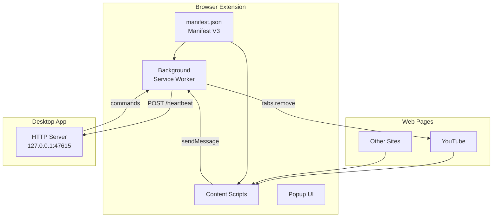

### API Protocol

**POST /v1/heartbeat**

```json
// Request
{
  "tabId": 123,
  "host": "youtube.com",
  "shorts": true,
  "swipes": 47,
  "audible": true,
  "active": true,
  "incognito": false
}

// Response
{
  "ok": true,
  "commands": [
    {"type": "close", "match": "shorts"}
  ]
}
```

**GET /v1/ping**

```json
// Response
{
  "app": "phi",
  "v": 1
}
```

### Security Model

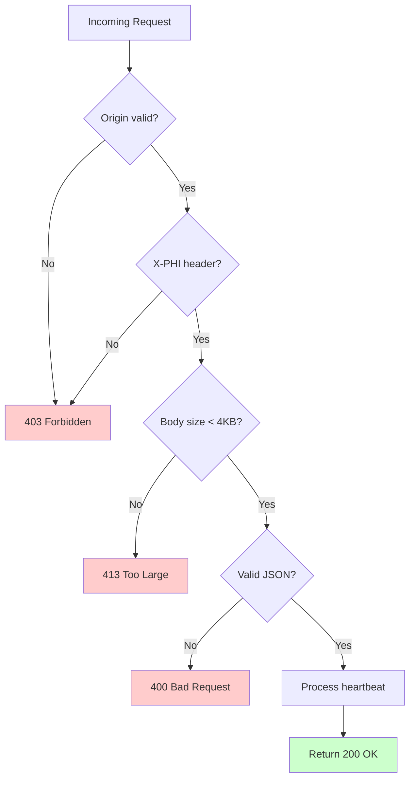

**Security Layers**:
1. **Network Isolation** — Server binds only to 127.0.0.1
2. **Origin Validation** — Must be chrome-extension:// or moz-extension://
3. **Header Validation** — Must include `X-PHI: 1`
4. **Payload Validation** — Max 4KB, type checking
5. **Data Minimization** — Only hostnames and booleans, never URLs or content

---

## Privacy & Security

### Data Collection Policy

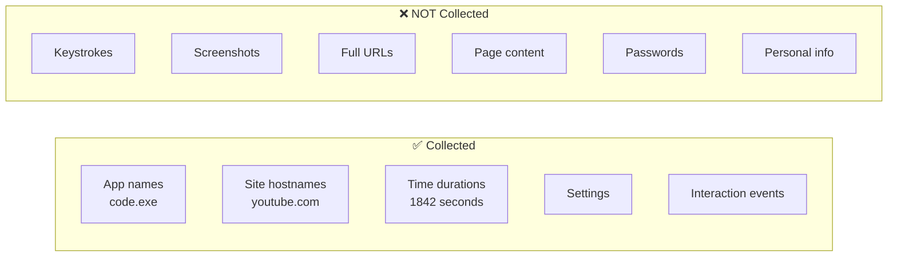

### What PHI Collects

- Application executable names (e.g., `code.exe`, `chrome.exe`)
- Website hostnames only (e.g., `youtube.com`, not full URLs)
- Time durations in seconds
- User settings and preferences
- Interaction events (nudge shown, action taken)

### What PHI Does NOT Collect

- ❌ Keystrokes or keypresses
- ❌ Mouse movements or clicks
- ❌ Screenshots or screen recordings
- ❌ Full URLs, page paths, or query strings
- ❌ Page titles or content
- ❌ Form data or input values
- ❌ Passwords or credentials
- ❌ Authentication tokens or cookies
- ❌ Any personally identifiable information

### Security Guarantees

| Guarantee | Implementation |
|-----------|---------------|
| **No Network Transmission** | All data stays on your computer |
| **No User Accounts** | No login, passwords, or tokens |
| **No Telemetry** | No usage stats or crash reports |
| **No Third-Party Services** | No analytics, CDNs, or external APIs |
| **Localhost-Only Comm** | Extension only talks to 127.0.0.1 |
| **No Admin Rights** | Installs and runs in user space |

---

## Development Roadmap

### Current Status

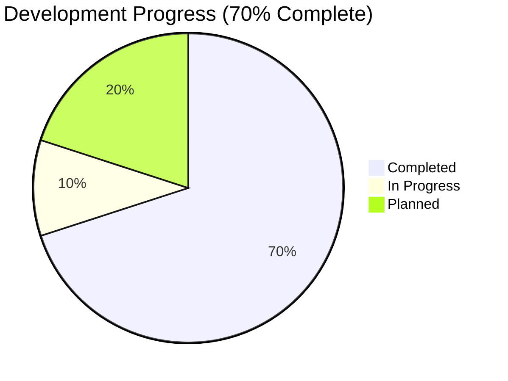

### Completed Features ✅

- [x] Core monitoring engine with QTimer loop
- [x] SQLite database with WAL journaling
- [x] Windows integration (foreground, idle, autostart)
- [x] HTTP bridge server for extension
- [x] Custom UI widget library
- [x] Three main pages (Today, Apps, Settings)
- [x] Theme and design system

### In Progress 🚧

- [ ] Browser extension (Chrome/Firefox)
- [ ] System tray icon
- [ ] Nudge popup window
- [ ] Main entry point refinement

### Planned 📋

**Phase 2**
- Mascot sprite animations
- Sound notifications
- Focus mode (block sites)

**Phase 3**
- Weekly reports
- Data export (JSON/CSV)
- Multiple mascot designs
- Custom themes

**Phase 4**
- macOS support
- Linux support
- Installer distribution

---

## Contributing

We welcome contributions!

### Code Style

- **Python**: Follow PEP 8
- **Type Hints**: Use type annotations
- **Docstrings**: Document all public methods
- **UI Components**: Match existing patterns

### Development Setup

```powershell
git clone https://github.com/yourusername/PHI_FOCUS.git
cd PHI_FOCUS
python -m venv .venv
.\.venv\Scripts\Activate.ps1
pip install -r requirements.txt
python -m phi
```

### Privacy Requirements

**IMPORTANT**: Never add:
- Telemetry or analytics
- Network calls to external servers
- Data collection beyond specified policy
- Any feature that compromises user privacy

---

## License

MIT License

Copyright (c) 2024 PHI Focus Contributors

Permission is hereby granted, free of charge, to any person obtaining a copy
of this software and associated documentation files (the "Software"), to deal
in the Software without restriction, including without limitation the rights
to use, copy, modify, merge, publish, distribute, sublicense, and/or sell
copies of the Software, and to permit persons to whom the Software is
furnished to do so, subject to the following conditions:

The above copyright notice and this permission notice shall be included in all
copies or substantial portions of the Software.

THE SOFTWARE IS PROVIDED "AS IS", WITHOUT WARRANTY OF ANY KIND, EXPRESS OR
IMPLIED, INCLUDING BUT NOT LIMITED TO THE WARRANTIES OF MERCHANTABILITY,
FITNESS FOR A PARTICULAR PURPOSE AND NONINFRINGEMENT. IN NO EVENT SHALL THE
AUTHORS OR COPYRIGHT HOLDERS BE LIABLE FOR ANY CLAIM, DAMAGES OR OTHER
LIABILITY, WHETHER IN AN ACTION OF CONTRACT, TORT OR OTHERWISE, ARISING FROM,
OUT OF OR IN CONNECTION WITH THE SOFTWARE OR THE USE OR OTHER DEALINGS IN THE
SOFTWARE.

---

<p align="center">
  <b>PHI Focus</b><br>
  <i>Stay intentional. Your time matters.</i>
</p>
