# PHI

<p align="center">
  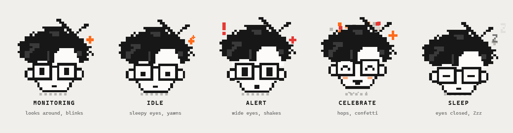
</p>

<p align="center">
  <b>A privacy-first desktop companion that notices when you are doomscrolling YouTube Shorts and stops you.</b><br>
  Everything runs on your computer. No account, no cloud, no telemetry.
</p>

<p align="center">
  
  
  
  
</p>

---

## Table of Contents

1. [What PHI does](#what-phi-does)
2. [Meet the mascot](#meet-the-mascot)
3. [Tech stack](#tech-stack)
4. [Architecture](#architecture)
5. [How detection works](#how-detection-works)
6. [The nudge](#the-nudge)
7. [Today and Activity](#today-and-activity)
8. [Timers and alarms](#timers-and-alarms)
9. [Themes](#themes)
10. [Animation and performance](#animation-and-performance)
11. [Data model](#data-model)
12. [Project structure](#project-structure)
13. [Install and run](#install-and-run)
14. [Build the installer](#build-the-installer)
15. [Browser extension](#browser-extension)
16. [Privacy and security](#privacy-and-security)
17. [Status](#status)
18. [Contributing](#contributing)
19. [License](#license)

---

## What PHI does

PHI sits in your system tray and watches which app or site is in focus, counting time only while you are actually active. When YouTube Shorts (or another site you watch) crosses a limit you set, PHI interrupts you with a full-screen lock or a small card, pauses the video, and closes the tab for you unless you decide otherwise.

- **Tracks time** for desktop apps and websites, with websites split three ways: **YouTube Shorts**, **YouTube** (without Shorts) and **every other site**.
- **Limits for all of them**: a daily limit per app, per website, and for YouTube, plus separate session and daily limits for Shorts.
- **Today** is a thoughtful overview (screen time, apps, websites, Shorts, when it happened, how close each limit is). **Activity** is the full history by day, week or month, and every bar opens that day hour by hour.
- **Detects Shorts** by reading the browser's address bar. The browser extension is optional.
- **Interrupts you** with a lock screen or a card, a siren, a countdown, and friction that grows each time it has to ask again.
- **Closes Shorts for you** through the extension, or with Ctrl+W when no extension is connected.
- **Reminds you to take breaks** with timers and alarms ("Take a break" every 30 minutes, or a message at 13:00) shown as a full-screen reminder with your own text.
- **Looks the way you like**: light, dark, or a custom theme from three colours, applied to the app, the lock screen and the reminders.
- **Keeps everything local** in a SQLite file under `%APPDATA%\PHI`.

Design rules: deterministic limits you control (no AI deciding anything), no keystroke logging, no screenshots, no page content.

---

## Meet the mascot

The mascot is a pixel-art nerd with wild hair, big square glasses, two antennae and one orange plus. It lives in the sidebar, the nudge card, the lock screen and the tray icon, and its mood follows what PHI sees.

| Engine state | Mascot mood | What it does |
|---|---|---|
| Normal activity | `monitoring` | Looks around (follows your cursor), blinks, glints its glasses, pushes them up now and then |
| No input / away | `idle` | Half-closed eyes, wandering gaze, occasional yawn |
| Shorts detected | `alert` | Wide eyes, shaking, red `!`, sweat drop, red plus |
| You chose to stop | `celebrate` | Happy eyes, blush, hops, confetti fountain |
| Tracking paused | `sleep` | Eyes closed, glasses slip down, floating Zs |

You can poke it in the sidebar. It hops, keep clicking and a `xN` combo appears, and after five quick clicks it gets dizzy. Hovering makes it smile.

---

## Tech stack

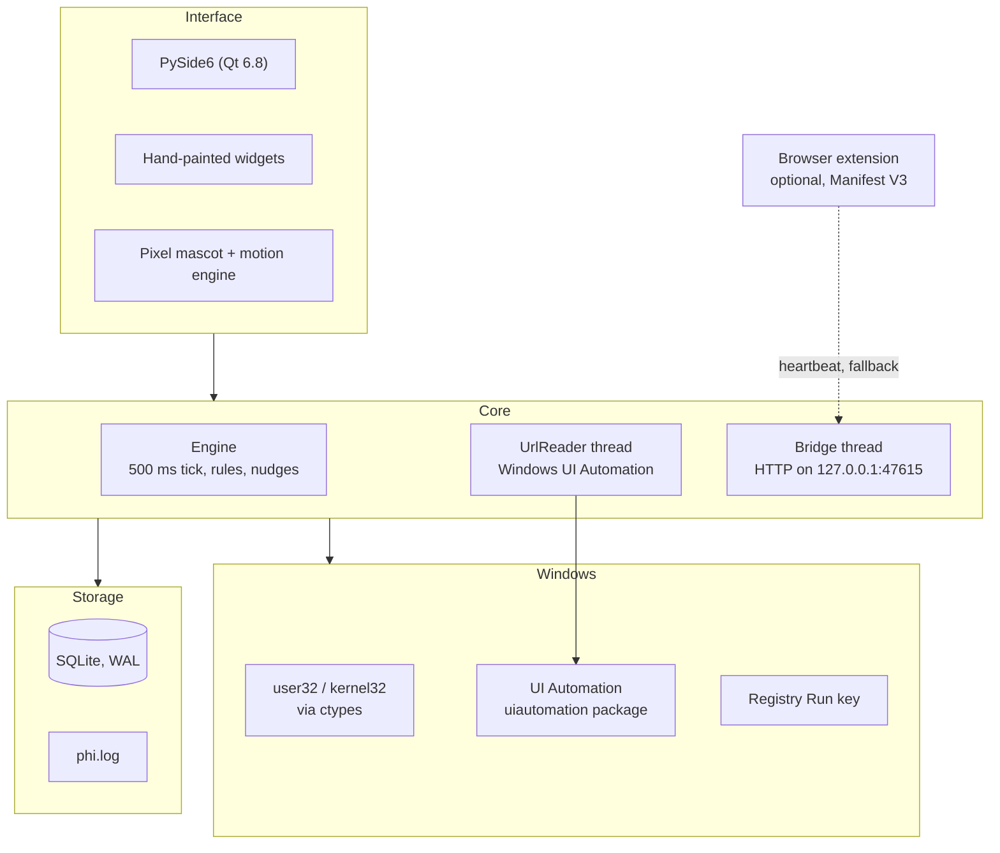

| Layer | Technology | Notes |
|---|---|---|
| UI | PySide6 6.8.3 | Everything is painted by hand with `QPainter`; no stylesheets for controls |
| Language | Python 3.12 | The build environment; 3.11+ should work |
| Address-bar reading | `uiautomation` 2.0.29 | Reads the omnibox of Chromium browsers |
| Storage | SQLite (WAL, `synchronous=NORMAL`) | One file, thread-safe through an `RLock` |
| Windows access | `ctypes` | Foreground window, idle time, focus, Ctrl+W, media key |
| Extension | Chromium Manifest V3 | Optional fallback; talks to `127.0.0.1` only |
| Packaging | PyInstaller + Inno Setup | `build.ps1` |

---

## Architecture

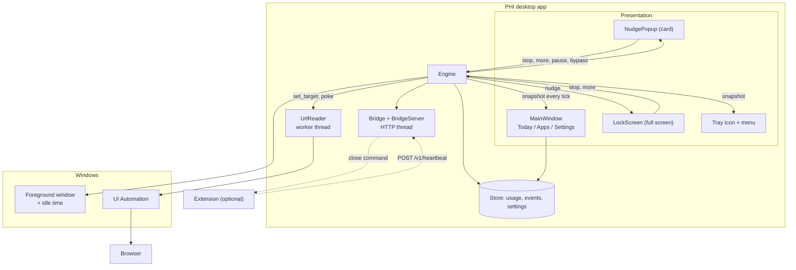

### Threads and timers

| Where | What | Cadence |
|---|---|---|
| Main thread | `Engine._tick`: decide state, record time, check limits | 500 ms |
| Main thread | Title watcher: wake the reader when the browser title changes | 40 ms |
| Main thread | Store flush | every 10 s |
| Main thread | `ReminderScheduler`: timers and alarms | 1 s |
| `phi-urlreader` | Read the address bar of the focused browser | about 80 ms, plus on demand |
| `phi-bridge` | HTTP server for the extension | event driven |
| Main thread | Animations | shared 16 ms clock, only while something moves |

---

## How detection works

PHI trusts the live address bar first. The extension heartbeat (every 4 s) is only a fallback, so detection does not wait for it.

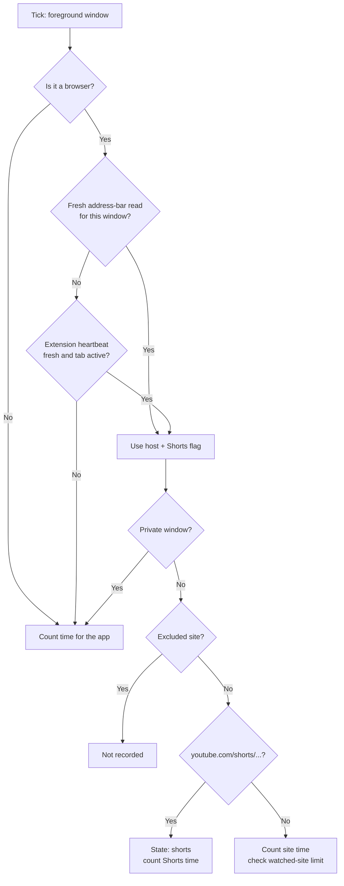

Time is only counted while there was input in the last `idle_threshold_s` seconds, or while the tab is playing audio. Clock jumps and sleep/resume are not counted.

**Sessions.** A Shorts session is continuous time on Shorts. Leaving Shorts for more than 4 seconds ends it, so closing Shorts and reopening it is a fresh check and triggers again straight away (with the session limit at `0`, as soon as it opens). "More time" only covers the session you are in.

Private windows are never read as a site: their time is counted only as time in the browser app, with no hostname.

Every navigation and every Short swipe changes the browser's window title. PHI watches the title (it is never stored) and uses a change as a signal to re-read the address bar immediately.

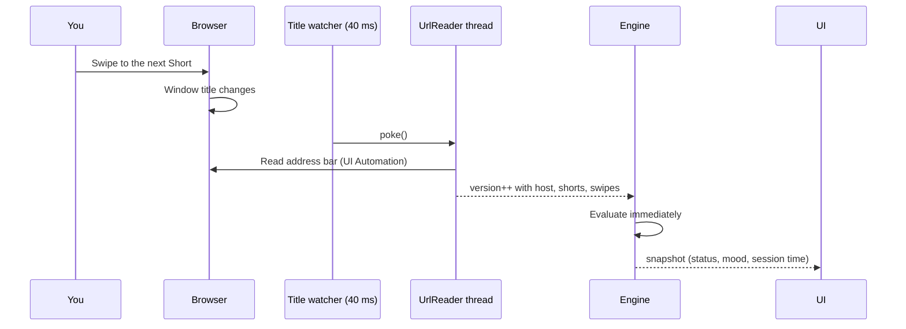

Reader status values land in the activity log: `ok`, `slow:<ms>`, `no-omnibox`, `error:<type>`, `unavailable`.

Supported for address-bar reading: Chrome, Edge, Brave, Vivaldi, Opera. Firefox is tracked as an app but its pages are not read.

---

## The nudge

When a limit is crossed, PHI shows either the **lock screen** (default) or a **card** (turn lockdown off in Settings).

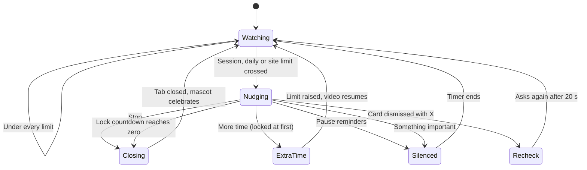

### Lock screen

- Covers every monitor, swallows mouse and keyboard, takes focus back if it loses it, and ignores Alt+F4.
- Counts down (`lockdown_seconds`, longer each time PHI has to ask again) and then closes Shorts for you.
- "More time" needs a long press, and the hold gets longer on repeats.
- Buttons are disabled for the first two seconds so a stray click cannot dismiss it.
- Follows your theme (light, dark or custom). It has no X button and no "pause reminders" option; those exist only on the card and in the tray menu.

### Card

- Dims the screen, drops in with a bounce, plays an alarm, and shows a marching hazard stripe.
- Shows live numbers: session clock, today's total, Shorts watched, nudge number.
- "More time" is locked for a few seconds, and the lock grows with each repeat.

### Pausing the video

With `pause_video` on (the default), either nudge presses the media Play/Pause key as it appears, so the Short stops playing behind it. If you choose anything except Stop, PHI presses the key again half a second later so the video carries on.

### How tabs get closed

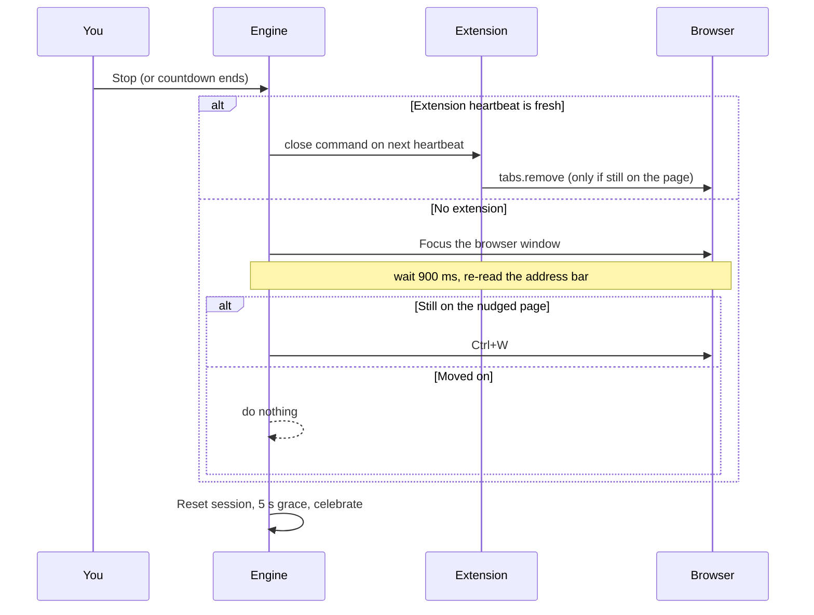

The only keys PHI ever sends are Ctrl+W (after re-checking the page) and the media Play/Pause key (to pause the video behind the lock).

---

## Today and Activity

**Today** shows four totals with a 7-day trend (screen time, apps, websites, YouTube Shorts), an insight line (peak hour, top item, Shorts share), a timeline of when apps, websites and Shorts were used, **Limits today** (a progress bar per limit that turns red near the end), and the top apps and top websites.

**Activity** is the full history:

- **Day / Week / Month** with previous and next buttons. A week runs Monday to Sunday.
- **All / Apps / Websites** filter. Websites are split into YouTube Shorts, YouTube (without Shorts) and other sites.
- **Click a bar** in the week or month chart to open that day. The day view shows the hourly chart, an hour-by-hour grid for the top eight apps and sites (the "spans"), and the breakdown. "← back" returns to the week or month.
- Hover any bar or cell to read the exact time.

**Limits** work the same way for every kind of item. Apps and websites have a daily limit in Settings (Watched apps, Watched websites). YouTube has its own limit that counts only non-Shorts time, and Shorts keep their session and daily budgets. When an app reaches its limit PHI shows the lock or card, and "stop" **minimizes** the app instead of closing it, so nothing is lost.

---

## Timers and alarms

Set them up in **Settings → Timers & alarms**. Each one has:

| Option | Meaning |
|---|---|
| On/off toggle | Disable it without deleting it |
| Message | Any text, for example "Take a break" or "Drink water" (long text wraps to fit) |
| Schedule | **Every** N minutes (1 to 720), or **At** a time of day (`HH:MM`) |
| Sound | Play a soft two-tone chime |
| test | Show it now without touching its schedule |
| remove | Delete it |

A reminder appears as a **full-screen screen in your theme** on every monitor, with your message, the time, and **Done** and **Snooze** buttons (Esc also means Done). Snooze length is a setting (`reminder_snooze_min`, default 5).

Rules:

- **Interval timers** count wall-clock time, and restart when you have been away from the keyboard for 5 minutes or more, because you already took a break.
- **Daily alarms** fire once at their time. A missed alarm (PHI was closed) is skipped, not replayed.
- **One at a time.** Only one reminder is on screen at once, and none appears while a Shorts lock is open; it waits until the screen is free.
- A starter timer, "Take a break" every 30 minutes, is included but switched **off**.

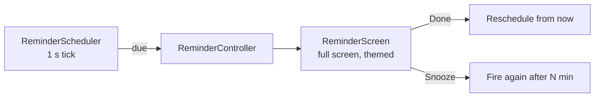

---

## Themes

**Settings → Appearance** switches between **Light**, **Dark** and **Custom**. The change is instant, with no restart, and the same palette is used by the main window, the Shorts lock, the card and the reminders.

For **Custom** you pick three colours: **Background**, **Text** and **Accent**. PHI derives everything else (cards, borders, chart cells, muted text) from those three, so any combination stays readable as long as text contrasts with the background.

Technically, `phi/ui/theme.py` holds the colour tokens (`BG`, `SURFACE`, `PAPER`, `INK`, `GRAY`, `RED`, `LINE`, `SOFT`, `CELL`, `BAR`, `EDGE`). `theme.apply()` swaps them, and the main window rebuilds itself on the same page. Windows that appear later (lock, card, reminders) read the tokens when they are built. Code should read colours as `T.INK` at paint or build time, never store them in a default argument.

---

## Animation and performance

The goal is motion that feels physical without costing anything while PHI sits in the tray.

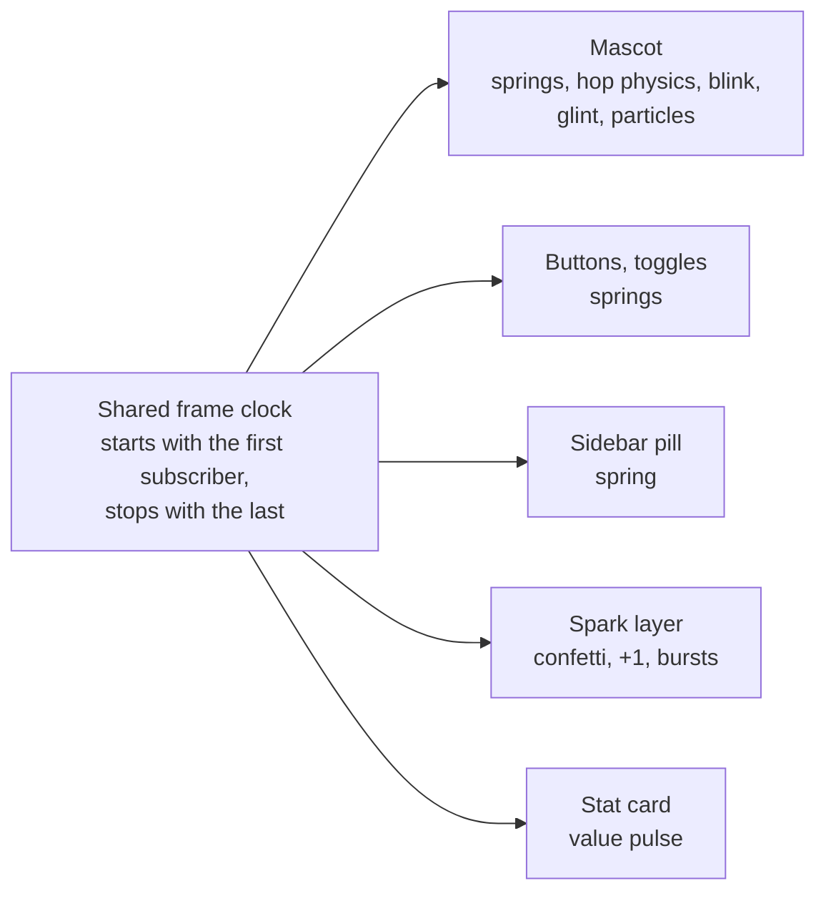

What makes it cheap and smooth:

- **One clock, and it sleeps.** `phi/ui/motion.py` runs a single 16 ms timer only while something is moving. When the main window is hidden, every animation unsubscribes and the timer stops completely; it starts again when the window is shown.
- **Springs for feel.** The sidebar pill, toggle knob, button press, mascot squash, hair and antennae all run on damped springs, so they overshoot and settle instead of easing linearly.
- **Cached pixel layers.** The mascot's skin, outline, hair and glasses are pre-rendered at a whole number of device pixels per cell, so edges stay crisp at any display scale. A frame only repaints when the quantised pose actually changed.
- **Tween, don't replay.** Routine data refreshes slide values and bars to their new numbers. The intro animation only plays when you open a page or the window.
- **Cheap page switches.** Pages switch instantly and animate their own contents in with a stagger. A full-page cross-fade re-rendered the whole page every frame, so it was removed.
- **Rows update in place.** The Apps list and the Top apps panel reuse their rows and animate to new values instead of rebuilding.
- **Fast writes.** SQLite runs in WAL mode with `synchronous=NORMAL`, so the periodic flush does not stall the UI thread on `fsync`. A power cut can lose the last moments of stats but cannot corrupt the file.

Micro-animations: buttons squash and pop pixel sparks when they fire, toggles stretch as they slide and spark when switched on, stepper numbers roll up or down, a stat card pulses when its value rises, timeline cells show a tag on hover, and stopping Shorts triggers confetti and a floating `+1 STOPPED`.

---

## Data model

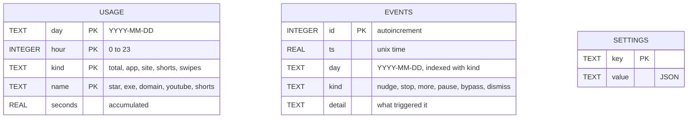

The tables are independent on purpose. `usage` and `events` only share the `day` column, and a day is the unit for retention.

### Settings

| Key | Default | Meaning |
|---|---|---|
| `reminders` | `true` | Show nudges at all |
| `lockdown` | `true` | Full-screen lock instead of the small card |
| `lockdown_seconds` | `10` | Countdown before PHI closes Shorts for you (grows on repeats) |
| `pause_video` | `true` | Pause the video behind the lock |
| `shorts_limit_min` | `20` | Continuous Shorts time before a nudge (`0` = nudge as soon as Shorts opens) |
| `shorts_daily_min` | `60` | Shorts budget per day (`0` = off) |
| `extend_min` | `5` | Length of "give me more time" |
| `pause_min` | `60` | Length of "pause reminders" |
| `bypass_min` | `30` | Length of "I'm using it for something important" |
| `idle_threshold_s` | `120` | No input for this long counts as away |
| `track_apps` | `true` | Record desktop apps, not just sites |
| `autostart` | `true` | Start with Windows (per-user Run key, no admin) |
| `retention_days` | `90` | Older days are deleted automatically |
| `watched_sites` | Instagram and Reddit on (15 min), TikTok, X and YouTube off | Per-website daily limits. The `youtube.com` entry counts YouTube **without Shorts** |
| `watched_apps` | none | Per-app daily limits, as `{exe, limit, enabled}`. When one is reached the app is **minimized**, never closed |
| `excluded_sites` | none | Sites that are never recorded |
| `theme_mode` | `light` | `light`, `dark` or `custom` |
| `theme_bg`, `theme_text`, `theme_accent` | `#F0EFEB`, `#171717`, `#E53935` | The three colours used by the custom theme |
| `reminder_items` | one "Take a break" every 30 min, off | List of timers and alarms: `id`, `message`, `mode` (`interval` or `daily`), `every_min`, `time`, `enabled`, `sound` |
| `reminder_snooze_min` | `5` | Length of Snooze on a reminder |

Environment variables: `PHI_DATA_DIR` moves the data folder, and `PHI_NO_AUTOSTART` stops PHI from writing the autostart entry.

---

## Project structure

```
PHI/
├── phi/
│   ├── __main__.py        python -m phi
│   ├── app.py             wiring: store, engine, tray, windows; single-instance lock
│   ├── engine.py          the 500 ms loop, limits, nudges, closing tabs
│   ├── reminders.py       timers and alarms scheduler
│   ├── urlreader.py       address-bar reader (UI Automation, worker thread)
│   ├── stats.py           read-side helpers: ranked items, YouTube/Shorts split, day/week/month periods
│   ├── server.py          localhost bridge for the extension
│   ├── db.py              SQLite store and settings
│   ├── winapi.py          foreground window, idle time, focus, Ctrl+W, media key
│   ├── autostart.py       per-user Run key
│   ├── utils.py           host normalisation, labels, time formatting
│   └── ui/
│       ├── main_window.py frameless window, spring sidebar, title bar
│       ├── dashboard.py   Today (overview) and Activity (day / week / month)
│       ├── pages.py       Settings and shared page helpers
│       ├── popup.py       the nudge card and its controller
│       ├── lockscreen.py  full-screen lockdown
│       ├── reminderscreen.py  full-screen timer/alarm and its controller
│       ├── mascot.py      the nerd: sprite layers, moods, ring, wordmark, icons
│       ├── motion.py      frame clock, springs, pixel sparks
│       ├── widgets.py     buttons, toggles, steppers, charts, cards
│       └── theme.py       light/dark/custom palettes, fonts, global stylesheet
├── extension/             Manifest V3 companion (optional)
├── tools/make_icons.py    renders phi.ico and the extension icons from the mascot
├── docs/                  images used by this README
├── build.ps1              PyInstaller + Inno Setup build
├── installer.iss          installer definition
├── run_phi.pyw            double-click launcher (no console)
└── requirements.txt
```

---

## Install and run

PHI runs on Windows 10 and 11 (64-bit). Pick one of three ways.

### Option 1: the installer (recommended)

1. Get `PHI-Setup.exe`. Build it yourself with `.\build.ps1` (see [Build the installer](#build-the-installer)); it lands in `installer_output\`.
2. Double-click it and follow the steps. It installs for your user only, so **no administrator rights are needed**. It also installs the Microsoft Visual C++ runtime if your PC lacks it.
3. Leave "Launch PHI" ticked and finish. PHI opens its window and puts a ghost icon in the system tray (click the `^` arrow if you cannot see it). Closing the window keeps PHI running in the tray; **Quit** is in the tray menu.
4. Optional: tick "Create a desktop shortcut" during setup. Start Menu shortcuts are always created.

Notes:

- **Windows SmartScreen** may say "Windows protected your PC" because the installer is not code-signed. Click **More info**, then **Run anyway**.
- **Start with Windows** is on by default and can be switched off in Settings. The uninstaller removes it.
- **Update** by running a newer `PHI-Setup.exe` over the old one. Your data in `%APPDATA%\PHI` is kept. If PHI is running, quit it from the tray first, or the old copy keeps running its old code.
- **Uninstall** from Windows Settings → Apps → PHI. Your data folder `%APPDATA%\PHI` is left behind; delete it if you want everything gone.
- The extension folder is copied to `<install folder>\extension`, in case you want the optional [browser extension](#browser-extension).

### Option 2: portable (no install)

Build with `.\build.ps1` and run `dist\PHI\PHI.exe`. Keep the whole `dist\PHI` folder together; the exe needs the `_internal` folder beside it.

### Option 3: from source

You need Python 3.12.

```powershell
git clone https://github.com/Abubakkar-Khan/PHI.git
cd PHI
py -3.12 -m venv .venv312
.\.venv312\Scripts\Activate.ps1
pip install -r requirements.txt

python -m phi                 # window + tray
python -m phi --background    # tray only
```

`run_phi.pyw` starts the same app without a console window.

### First run

1. Open **Settings** and set **Shorts session limit** (`0` locks as soon as Shorts opens, `20` after 20 continuous minutes).
2. Optional: pick a theme under **Appearance**, and add timers under **Timers & alarms**.
3. Open YouTube Shorts in Chrome, Edge, Brave, Vivaldi or Opera. The Today screen's chip changes to `SHORTS DETECTED`. No extension is needed.

### Troubleshooting

- **"Failed to load Python DLL" or a missing-DLL error.** Install from `PHI-Setup.exe` (it bundles the Visual C++ runtime) instead of copying `PHI.exe` out of its folder. If an antivirus quarantined a file, restore it and allow PHI.
- **Nothing changed after an update.** Only one PHI can run at a time (a lock file in your temp folder). A copy that is still in the tray keeps running its old code. Quit it from the tray menu, then start PHI again.
- **Shorts is not detected.** Open `%APPDATA%\PHI\phi.log` and look for `reader:` lines. `no-omnibox` means the address bar was not found (full-screen mode hides it), and `unavailable` means the `uiautomation` package is missing. Firefox pages are not read.
- **Where is my data?** `%APPDATA%\PHI` (database `phi.db` and the log `phi.log`). To start fresh, quit PHI and delete that folder.
- **The popup does not appear.** Check that "Reminders" is on and that "Shorts session limit" is what you expect (`0` = right away). An earlier "More time" only covers the session you were in.
- **A reminder never shows.** Timers are off until you switch their toggle on in Settings. Use **test** on the row to preview it.

### Developing without a display

```powershell
$env:QT_QPA_PLATFORM = "offscreen"
```

Widgets can be built, stepped and rendered with `grab()` in this mode. Fonts may differ from a normal run.

---

## Build the installer

```powershell
.\.venv312\Scripts\python.exe -m pip install pyinstaller
.\build.ps1
```

The script regenerates the icons from the mascot, builds `dist\PHI\PHI.exe` with PyInstaller, and then builds `installer_output\PHI-Setup.exe` if Inno Setup 6 is installed. It downloads the Visual C++ redistributable into `redist\` on first run. Build output is git-ignored.

---

## Browser extension

The extension is optional. PHI reads the address bar itself, so the extension only adds a fallback and a clean way to close tabs.

**Install (Chrome, Edge, Brave):** open `chrome://extensions`, turn on Developer mode, choose Load unpacked, and select the `extension/` folder.

- **Permissions:** `tabs` and `alarms`, and host access to `http://127.0.0.1:47615/*` only.
- **What it sends:** a hostname and a few booleans every 4 s. Never URLs, titles or page content, and nothing from private windows.
- **What it does:** counts distinct Shorts viewed in a tab (from the URL path), and closes the active tab when PHI sends a `close` command and the tab is still on the nudged page.
- **Status:** a `!` badge appears when the PHI app is not running.

### Local API

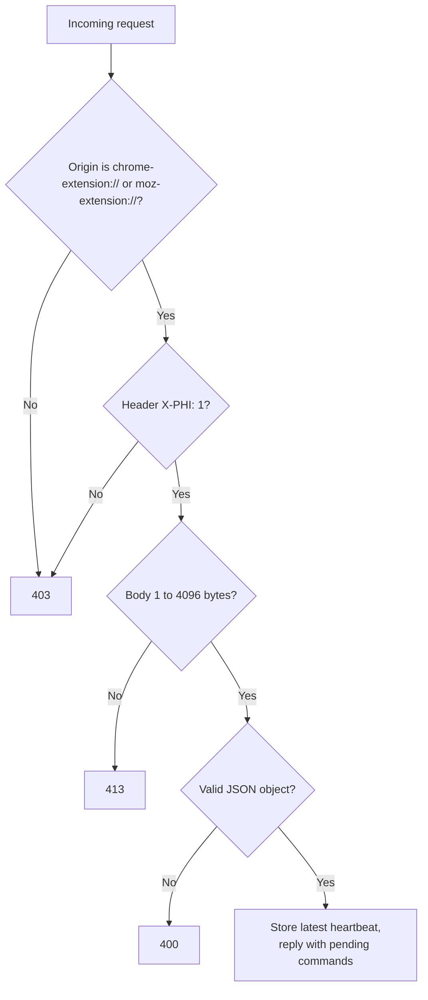

`POST /v1/heartbeat` takes `{tabId, host, shorts, swipes, audible, active, incognito}` and replies `{"ok": true, "commands": [{"type": "close", "match": "shorts"}]}`. `GET /v1/ping` replies `{"app": "phi", "v": 1}`. The server binds to `127.0.0.1` only.

---

## Privacy and security

**PHI stores**

- App executable names (for example `code.exe`) and site hostnames (for example `youtube.com`).
- Seconds per hour, per day.
- Events: when a nudge appeared and what you chose.
- Your settings.
- An activity log, `%APPDATA%\PHI\phi.log` (rotated at about 200 KB), with timestamps, state changes such as `state active / Brave`, nudges, and reader status. It holds app and site labels, never URLs.

**PHI never stores or sends**

- Keystrokes, mouse activity, screenshots or screen recordings.
- Full URLs, page paths, page titles or page content.
- The sites you visit in private or incognito windows. Those windows count only as time in the browser app.
- Anything over the network. The only socket is the local one for the extension.

**How the address-bar reader stays private.** It reads the address bar in memory, keeps the hostname, a Shorts flag and a private-window flag, and discards the rest. The window title is used only as a "something changed" signal and is never stored or logged.

**Keys PHI sends.** Ctrl+W (only after re-checking that the browser is still on the nudged page) and the media Play/Pause key (to pause the video behind the lock). Nothing else.

**Other guarantees.** No telemetry, no account, no admin rights, and autostart uses the per-user Run key. Old days are deleted automatically after `retention_days`, and quitting PHI and deleting `%APPDATA%\PHI` removes everything it has stored.

---

## Status

| Area | State |
|---|---|
| Monitoring engine, limits, idle handling | Implemented |
| Address-bar detection (Chromium) | Implemented, extension is a fallback |
| Browser extension (MV3) | Implemented |
| Today, Activity (day / week / month with drill-down), Settings pages | Implemented |
| Limits for apps, YouTube, YouTube Shorts and other websites | Implemented |
| Nudge card and full-screen lockdown | Implemented |
| Tray icon and menu | Implemented |
| Timers and alarms (interval or daily, full-screen) | Implemented |
| Light, dark and custom themes | Implemented |
| Nerd mascot with five moods and micro-animations | Implemented |
| Installer build (PyInstaller + Inno Setup) | Scripts in the repo |

Known gaps:

- Firefox pages are not read by the address-bar reader.
- Windows only (Win32 and UI Automation).
- The repository has no automated tests yet.
- The repository has no license file yet.

---

## Contributing

- Follow PEP 8 and match the existing widget style in `phi/ui/widgets.py`.
- Keep privacy intact: no telemetry, no outbound network calls, no storing URLs, titles or page content.
- Put animation work on the shared clock in `phi/ui/motion.py` so it sleeps when idle.
- If you change the mascot, regenerate the icons with `python tools/make_icons.py`.

---

## License

No license has been chosen yet. Until one is added, all rights are reserved by the author.

---

<p align="center">
  <b>PHI</b><br>
  <i>Stay intentional. Your time matters.</i>
</p>
